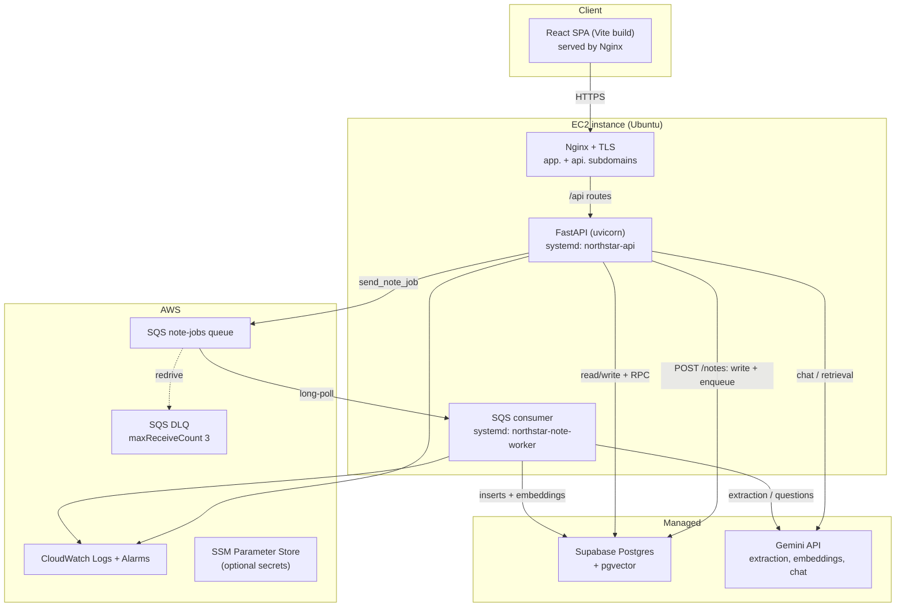

# EC2 Deployment Guide — NorthStar

Deploy the FastAPI backend and the SQS note worker to a single EC2 instance,
with **Supabase** (managed Postgres + pgvector) as the database and **Gemini**
for LLM/embeddings. The React SPA is built with Vite and served as static files
by Nginx on the same box.

This replaces the earlier Chroma-on-EBS design: the runtime vector store is now
`pgvector` in Supabase ([phase4_pgvector.sql](../backend/sql/phase4_pgvector.sql)),
so there is **no local vector index to own, snapshot, or pin to one instance**.

---

## 0. Architecture



Requests flow: browser → Nginx → FastAPI. `POST /notes` writes the note as
`processing`, enqueues an SQS job, and returns `202`. The worker consumes the
job, enriches the note, writes memory rows and recall candidates, generates
questions if `recall_enabled`, embeds chunks into pgvector, then marks the note
`completed`.

---

## 1. Prerequisites

- AWS account, an EC2 key pair, and a region chosen to sit near your Supabase
  project (lower latency, no cross-region egress on every request).
- A Supabase project with the SQL migrations applied (see §4).
- A Gemini API key.
- Two DNS records pointing at the instance's Elastic IP:
  `app.example.com` and `api.example.com`.

---

## 2. Provision AWS

1. **Instance:** Ubuntu 24.04 LTS, `t3.medium` (2 vCPU / 4 GB) is a safe start.
   `t4g.medium` works too if your dependencies install ARM wheels. You can drop
   to `t3.small` if you skip the optional `sentence-transformers` install (§3).
2. **Storage:** 30 GB `gp3` root volume. No separate vector volume is needed.
3. **Elastic IP:** allocate and associate it so DNS survives reboots.
4. **Security group:**
   - inbound 80/443 from `0.0.0.0/0`
   - inbound 22 from **your IP only** — never `0.0.0.0/0`
   - no inbound access to 8000 (uvicorn binds to loopback)
5. **IAM instance role** (attach to the instance; do not put static AWS keys in
   `.env`). Minimal policy for a standard queue:

   ```json
   {
     "Version": "2012-10-17",
     "Statement": [{
       "Effect": "Allow",
       "Action": [
         "sqs:SendMessage",
         "sqs:ReceiveMessage",
         "sqs:DeleteMessage",
         "sqs:GetQueueAttributes",
         "sqs:ChangeMessageVisibility"
       ],
       "Resource": "arn:aws:sqs:<region>:<account-id>:northstar-note-jobs"
     }]
   }
   ```

6. **SQS queue:**
   - Type: **Standard** (simplest) or **FIFO** if you want strict per-note
     ordering. `send_note_job` sets `MessageGroupId` only for `.fifo` URLs.
   - Visibility timeout: **600 s** (must exceed worst-case note processing:
     enrichment + question generation + embeddings).
   - Message retention: 4 days.
   - Dead-letter queue: create `northstar-note-jobs-dlq`, set
     `maxReceiveCount` to **3** on the main queue's redrive policy.
   - Record the queue URL for `SQS_QUEUE_URL`.

---

## 3. Server setup

```bash
sudo apt update && sudo apt upgrade -y
sudo apt install -y python3-venv python3-pip nginx git postgresql-client

sudo useradd --create-home --shell /usr/sbin/nologin northstar
sudo mkdir -p /opt/northstar
sudo chown northstar:northstar /opt/northstar

sudo -u northstar git clone <your-repo-url> /opt/northstar
cd /opt/northstar

sudo -u northstar python3 -m venv .venv
sudo -u northstar .venv/bin/pip install --upgrade pip
sudo -u northstar .venv/bin/pip install -r backend/requirements.txt
```

> `requirements.txt` includes `sentence-transformers` (and therefore `torch`),
> which is only needed for local embeddings or the semantic reranker. With the
> defaults (`EMBEDDING_PROVIDER=google`, token-overlap reranker) you can omit it
> to save ~2 GB of disk and install time:
> `sudo -u northstar .venv/bin/pip install -r <(grep -v -E 'sentence-transformers|chromadb' backend/requirements.txt)`
> Do not omit it if you enable `EMBEDDING_PROVIDER=local` or
> `QUERY_RETRIEVAL_RERANKER=semantic`.

---

## 4. Database migrations

The app stores everything in Supabase; run the SQL **there**, not on EC2.
Follow [backend/sql/README.md](../backend/sql/README.md). Summary:

```bash
export SUPABASE_DB_URL='postgresql://postgres:<password>@db.<project>.supabase.co:5432/postgres'
./backend/scripts/apply_migrations.sh
```

Or run these files in order in the Supabase SQL editor:

1. `auth_jwt.sql`
2. `chat_conversations.sql`
3. `phase3_work_memory.sql`
4. `phase4_recall.sql`
5. `phase4_recall_scheduler.sql`
6. `phase4_pgvector.sql` (enable the `vector` extension first if needed)

Verify all 22 tables exist with the query in the root
[README](../README.md#2-set-up-the-database).

**Backfill existing notes** once after `phase4_pgvector.sql` (new notes embed
automatically):

```bash
cd /opt/northstar
sudo -u northstar .venv/bin/python -m backend.scripts.backfill_pgvector
```

Keep `EMBEDDING_DIMENSIONS=768`; it must match `vector(768)`.

---

## 5. Environment

```bash
sudo -u northstar cp backend/.env.example backend/.env
sudo -u northstar chmod 600 backend/.env
sudo -u northstar nano backend/.env
```

Required for a working deployment:

| Variable | Value |
|---|---|
| `GEMINI_API_KEY` | your key |
| `SUPABASE_URL` | project URL |
| `SUPABASE_KEY` | service-role key (server-side only) |
| `JWT_SECRET_KEY` | `openssl rand -hex 32` |
| `CORS_ALLOW_ORIGINS` | `https://app.example.com` |
| `PROCESS_NOTES_INLINE` | `false` |
| `SQS_QUEUE_URL` | queue URL from §2 |
| `AWS_REGION` | e.g. `us-east-1` |
| `EMBEDDING_PROVIDER` | `google` |
| `EMBEDDING_DIMENSIONS` | `768` |

Leave `AWS_ENDPOINT_URL` unset. Never commit `.env`; `.gitignore` already
excludes it. For a step up from a plaintext file, load the secrets from SSM
Parameter Store (`SecureString`) in the systemd `ExecStartPre` or a small
startup script.

---

## 6. systemd services

Create `/etc/systemd/system/northstar-api.service`:

```ini
[Unit]
Description=NorthStar FastAPI backend
After=network.target

[Service]
WorkingDirectory=/opt/northstar/backend
EnvironmentFile=/opt/northstar/backend/.env
ExecStart=/opt/northstar/.venv/bin/uvicorn app.main:app --host 127.0.0.1 --port 8000 --workers 2
Restart=on-failure
RestartSec=5
User=northstar

[Install]
WantedBy=multi-user.target
```

Create `/etc/systemd/system/northstar-note-worker.service`:

```ini
[Unit]
Description=NorthStar note-processing SQS consumer
After=network.target

[Service]
WorkingDirectory=/opt/northstar/backend
EnvironmentFile=/opt/northstar/backend/.env
ExecStart=/opt/northstar/.venv/bin/python -m app.workers.sqs_consumer
Restart=always
RestartSec=5
User=northstar

[Install]
WantedBy=multi-user.target
```

Enable and start:

```bash
sudo systemctl daemon-reload
sudo systemctl enable --now northstar-api northstar-note-worker
sudo systemctl status northstar-api northstar-note-worker
curl -s http://127.0.0.1:8000/health   # {"status":"ok"}
```

`--workers 2` is a starting point for 2 vCPU; each worker is a separate process.
Watch memory before increasing it.

---

## 7. Nginx + TLS

`/etc/nginx/sites-available/northstar`:

```nginx
server {
    listen 80;
    server_name app.example.com;

    root /opt/northstar/frontend/dist;
    index index.html;

    location /assets/ {
        expires 1y;
        add_header Cache-Control "public, immutable";
    }

    location / {
        try_files $uri $uri/ /index.html;
    }
}

server {
    listen 80;
    server_name api.example.com;

    location / {
        proxy_pass http://127.0.0.1:8000;
        proxy_set_header Host $host;
        proxy_set_header X-Real-IP $remote_addr;
        proxy_set_header X-Forwarded-For $proxy_add_x_forwarded_for;
        proxy_set_header X-Forwarded-Proto $scheme;
        proxy_read_timeout 120s;     # chat/embedding calls can be slow
        client_max_body_size 10m;
    }
}
```

```bash
sudo ln -s /etc/nginx/sites-available/northstar /etc/nginx/sites-enabled/
sudo nginx -t && sudo systemctl reload nginx
sudo apt install -y certbot python3-certbot-nginx
sudo certbot --nginx -d app.example.com -d api.example.com
```

`app.example.com` serves the SPA; `api.example.com` proxies to uvicorn with TLS
terminated by Nginx.

---

## 8. Frontend build

Vite inlines `VITE_API_BASE_URL` at **build time** — set it before building and
rebuild whenever the API URL changes.

```bash
cd /opt/northstar/frontend
sudo -u northstar cp .env.example .env
# set VITE_API_BASE_URL=https://api.example.com
sudo -u northstar npm ci
sudo -u northstar npm run build     # outputs frontend/dist
```

The Nginx `root` above points at `/opt/northstar/frontend/dist`. Re-run the
build on every frontend deploy.

If you prefer to build in CI, upload the resulting `dist/` to the instance
(e.g. `rsync`) instead of running Node there.

---

## 9. Go-live checklist

- [ ] Supabase migrations 1–6 applied; 22 tables verified.
- [ ] `backfill_pgvector` run (skip if the database has no notes yet).
- [ ] `GEMINI_API_KEY`, `SUPABASE_URL`, `SUPABASE_KEY`, `JWT_SECRET_KEY` set.
- [ ] `CORS_ALLOW_ORIGINS=https://app.example.com` (not `*`).
- [ ] `PROCESS_NOTES_INLINE=false`.
- [ ] SQS queue + DLQ created; redrive `maxReceiveCount=3`; visibility 600 s.
- [ ] Instance role has SQS send/receive/delete (no static AWS keys on disk).
- [ ] Security group: 22 restricted to your IP; 80/443 public; 8000 closed.
- [ ] Both systemd services enabled and healthy.
- [ ] `/health` returns `{"status":"ok"}` over HTTPS.
- [ ] Frontend built with `VITE_API_BASE_URL=https://api.example.com`.
- [ ] Nginx SPA fallback works (deep link refresh on `/app/recall`).
- [ ] Certbot renewed (`sudo certbot renew --dry-run`).
- [ ] Smoke test below passes end-to-end.
- [ ] CloudWatch alarms set for SQS depth and DLQ > 0.
- [ ] Log retention configured (see §10).

### Smoke test

```bash
API=https://api.example.com

curl -s $API/health

# Register (or log in) and capture the access token.
TOKEN=$(curl -s -X POST $API/auth/register \
  -H 'Content-Type: application/json' \
  -d '{"email":"deploy-test@example.com","password":"correct-horse-battery"}' \
  | python3 -c 'import sys,json; print(json.load(sys.stdin)["access_token"])')

# Create a recall-enabled note; expect 202 + note_id.
NOTE=$(curl -s -X POST $API/notes \
  -H "Authorization: Bearer $TOKEN" -H 'Content-Type: application/json' \
  -d '{"text":"Met the design team. We decided to simplify onboarding. Risk: the API deadline is tight.","recall_enabled":true}')
echo "$NOTE"
NOTE_ID=$(echo "$NOTE" | python3 -c 'import sys,json; print(json.load(sys.stdin)["note_id"])')

# Poll until status=completed (worker is running).
sleep 20
curl -s $API/notes/$NOTE_ID -H "Authorization: Bearer $TOKEN"

# Suggestions should exist; accept one, then it appears in the due queue.
curl -s "$API/recall/candidates?status=suggested&limit=5" -H "Authorization: Bearer $TOKEN"
```

Then open `https://app.example.com`, log in, create a note with **Add to
Recall**, accept a suggestion, and complete a review. The dashboard nav badge
should reflect due/new cards.

---

## 10. Observability, backups, cost

- **Logs:** `journalctl -u northstar-api -u northstar-note-worker -f`. Install
  the CloudWatch agent to ship journald output; set a 30–90 day retention
  policy. The Gemini prompt/response trace log is **off** by default
  (`PROMPT_LOG_ENABLED=false`) because it contains full note text.
- **Alarms:** SQS `ApproximateNumberOfMessagesVisible` (backlog),
  DLQ depth > 0, instance CPU credit balance (burstable), disk usage.
- **Backups:** Supabase handles database backups on paid plans. Confirm the
  retention window; optionally schedule `pg_dump` for an independent copy.
  There is no Chroma volume to snapshot anymore.
- **Cost:** `t3.medium` + 30 GB `gp3` is the baseline. A 1-year Compute Savings
  Plan cuts ~30–40% once the instance size is settled. Set CloudWatch Logs
  retention to avoid unbounded storage.

---

## 11. Rollback

```bash
# Code
sudo -u northstar git -C /opt/northstar fetch --all
sudo -u northstar git -C /opt/northstar checkout <previous-tag-or-sha>
sudo -u northstar /opt/northstar/.venv/bin/pip install -r backend/requirements.txt
sudo systemctl restart northstar-api northstar-note-worker

# Frontend
cd /opt/northstar/frontend && sudo -u northstar npm ci && sudo -u northstar npm run build
```

Migrations are additive and idempotent; rolling back code does not require
reverting schema. Never drop tables/columns to roll back a deploy.

---

## 12. Notes & known constraints

- `POST /notes/poll/process-jobs` remains a **debug-only** endpoint. Queue
  consumption belongs to `northstar-note-worker`; do not rely on the HTTP
  endpoint in production.
- Because the vector index lives in Postgres, the API tier is now stateless and
  **can** scale horizontally behind an ALB later. You do not need that today.
- Only one worker is needed to start. Increase concurrency by running more
  worker services/replicas; SQS distributes messages. Note that Gemini and
  embedding calls are the real throughput limit.
- `EMBEDDING_DIMENSIONS` and the `vector(768)` columns must stay in sync.
  Changing the embedding model requires a migration and full re-embed.
- `PROCESS_NOTES_INLINE=true` is for local debugging only; with it, note
  processing runs inside the API request and can time out.
