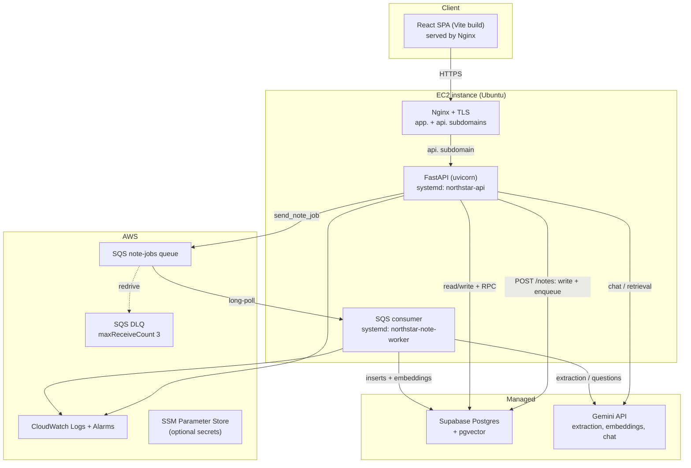

# EC2 Deployment Guide — NorthStar

Deploy the FastAPI backend and the SQS note worker to a single EC2 instance,
with **Supabase** (managed Postgres + pgvector) as the database and **Gemini**
for LLM/embeddings. The React SPA is built with Vite and served as static files
by Nginx on the same box.

This replaces the earlier Chroma-on-EBS design: the runtime vector store is now
`pgvector` in Supabase ([phase4_pgvector.sql](../backend/sql/phase4_pgvector.sql)),
so there is **no local vector index to own, snapshot, or pin to one instance**.

> **Who this is for:** a first production deployment from your own PC. Commands
> are bash; on Windows use WSL or Git Bash (the AWS CLI works there too). If you
> prefer the AWS console, use it for EC2/SQS/IAM with the settings described
> here.

---

## 0. Architecture and order of operations



Requests flow: browser → Nginx → FastAPI. `POST /notes` writes the note as
`processing`, enqueues an SQS job, and returns `202`. The worker consumes the
job, enriches the note, writes memory rows and recall candidates, generates
questions if `recall_enabled`, embeds chunks into pgvector, then marks the note
`completed`.

Do the phases in this order — each one has a checkpoint so you never debug two
layers at once:

| # | Phase | Checkpoint before moving on |
|---|---|---|
| 1 | AWS resources ([§2](#2-provision-aws)) | Queue URL + instance profile exist |
| 2 | Server bootstrap ([§3](#3-server-setup)) | `python -c "import fastapi"` works |
| 3 | Database migrations ([§4](#4-database-migrations)) | 22 tables + `vector(768)` |
| 4 | Environment ([§5](#5-environment)) | Preflight script prints `preflight OK` |
| 5 | systemd ([§6](#6-systemd-services)) | `/health` on loopback |
| 6 | Nginx + TLS ([§7](#7-nginx--tls)) | `https://api…/health` works |
| 7 | Frontend build ([§8](#8-frontend-build)) | `https://app…` loads |
| 8 | Smoke test ([§10](#10-smoke-test)) | Note reaches `completed` |

---

## 1. Prerequisites

- AWS account, an EC2 key pair, and a region chosen to sit near your Supabase
  project.
  **Why:** every chat/retrieval request crosses EC2 → Supabase and EC2 →
  Gemini; a nearby region removes avoidable latency and cross-region egress.
- A Supabase project (the SQL migrations are §4).
  Free tier is fine for a test, but free projects **pause after inactivity**;
  use a paid plan for anything you expect to stay online.
- A Gemini API key from <https://aistudio.google.com/apikey>.
- Two DNS records you can edit: `app.example.com` and `api.example.com`.
- On your PC: **AWS CLI v2**, `git`, `ssh`, and `dig` (or `nslookup`).
  Verify:

  ```bash
  aws configure                        # once, if the CLI has no profile yet
  aws --version
  aws sts get-caller-identity          # must show your account
  git --version
  ssh -V
  dig +short app.example.com           # fine if empty for now
  ```

> **Why two hostnames?** The SPA is served from `app.` and the API from `api.`
> That keeps CORS explicit (`https://app.example.com`), lets Nginx cache the
> SPA independently, and avoids rewriting API paths in Vite or Nginx. The SPA
> itself must be served over HTTPS: browser speech APIs (the note microphone)
> require a secure context.

---

## 2. Provision AWS

> If you want to attach the IAM instance profile at launch, create it first
> (§2.3). Otherwise launch the instance now and attach the profile afterward.

Set these once in your shell (use the region you actually deploy in):

```bash
export AWS_REGION=us-east-1
export APP_DOMAIN=app.example.com
export API_DOMAIN=api.example.com
export ACCOUNT_ID=$(aws sts get-caller-identity --query Account --output text)
```

### 2.1 EC2 instance

Console → **EC2 → Launch instance**:

1. **Name:** `northstar-prod`.
2. **AMI:** Ubuntu Server 24.04 LTS (64-bit x86; use the 64-bit ARM AMI if you
   picked `t4g.medium`).
3. **Instance type:** `t3.medium` (2 vCPU / 4 GB) is a safe start.
   **Why:** the first deploy installs Python packages and runs a Vite build on
   the box; 4 GB avoids the OOM killer. `t4g.medium` also works (ARM wheels are
   available once the optional `sentence-transformers`/`torch` install is
   skipped). `t3.small` is usable only with the slim dependency install in §3.
4. **Key pair:** create/select one; you need the `.pem` to SSH.
5. **Network:** default VPC, a public subnet, **Auto-assign public IP: enabled**.
6. **Security group** (new, name `northstar-web`):
   - SSH (22) from **My IP** only — never `0.0.0.0/0`.
   - HTTP (80) and HTTPS (443) from `0.0.0.0/0`.
   - Do **not** open 8000. **Why:** uvicorn binds to loopback and only Nginx
     should reach it; exposing 8000 bypasses TLS and the CORS boundary.
7. **Storage:** 30 GiB `gp3`.
   **Why:** OS + venv + Node build output. There is no Chroma volume anymore.
8. **Advanced → IAM instance profile:** select `NorthStarEC2Profile` from §2.3
   (create the profile first if the dropdown is empty; you can also attach it
   after launch).

Optional user data (installs the OS packages before your first SSH, so §3
starts at the clone step):

```bash
#!/bin/bash
export DEBIAN_FRONTEND=noninteractive
apt-get update
apt-get -y -o Dpkg::Options::="--force-confold" upgrade
apt-get install -y python3-venv python3-pip nginx git postgresql-client \
  ca-certificates curl gnupg dnsutils
apt-get install -y awscli || echo "awscli unavailable; verification can use boto3"
curl -fsSL https://deb.nodesource.com/setup_22.x | bash -
apt-get install -y nodejs
useradd --create-home --user-group --shell /usr/sbin/nologin northstar
mkdir -p /opt/northstar && chown northstar:northstar /opt/northstar
timedatectl set-timezone UTC
```

### 2.2 Elastic IP

Console → **EC2 → Elastic IPs → Allocate**, then **Associate** it with the
instance.

**Why:** the default public IPv4 changes if the instance is stopped/started;
an Elastic IP keeps DNS and TLS stable. AWS bills public IPv4 addresses hourly
(including attached Elastic IPs), so this is not free — but it avoids
re-pointing DNS and reissuing certificates after every stop/start.

Then create the DNS records (TTL 300 while setting up):

```bash
# Both should eventually return the Elastic IP.
dig +short $APP_DOMAIN
dig +short $API_DOMAIN
```

### 2.3 IAM instance role (no access keys on disk)

The API sends to SQS; the worker receives/deletes. One instance role covers
both processes. **Why an instance role:** boto3 gets short-lived credentials
from the EC2 metadata service, so there is no long-lived AWS key in `.env` and
nothing to leak from a backup. Split the role later if you move the worker to
its own instance.

Create the policy, role, and instance profile (run once; skip any line whose
resource already exists):

```bash
cat > /tmp/northstar-sqs-policy.json <<EOF
{
  "Version": "2012-10-17",
  "Statement": [{
    "Effect": "Allow",
    "Action": [
      "sqs:SendMessage",
      "sqs:ReceiveMessage",
      "sqs:DeleteMessage",
      "sqs:GetQueueAttributes",
      "sqs:GetQueueUrl",
      "sqs:ChangeMessageVisibility"
    ],
    "Resource": "arn:aws:sqs:${AWS_REGION}:${ACCOUNT_ID}:northstar-note-jobs"
  }]
}
EOF

cat > /tmp/ec2-trust.json <<'EOF'
{
  "Version": "2012-10-17",
  "Statement": [{
    "Effect": "Allow",
    "Principal": {"Service": "ec2.amazonaws.com"},
    "Action": "sts:AssumeRole"
  }]
}
EOF

aws iam create-policy \
  --policy-name NorthStarSqsNoteJobs \
  --policy-document file:///tmp/northstar-sqs-policy.json

aws iam create-role \
  --role-name NorthStarEC2Role \
  --assume-role-policy-document file:///tmp/ec2-trust.json

aws iam attach-role-policy \
  --role-name NorthStarEC2Role \
  --policy-arn "arn:aws:iam::${ACCOUNT_ID}:policy/NorthStarSqsNoteJobs"

aws iam create-instance-profile --instance-profile-name NorthStarEC2Profile
aws iam add-role-to-instance-profile \
  --instance-profile-name NorthStarEC2Profile \
  --role-name NorthStarEC2Role
```

If you did not attach the profile at launch:

```bash
export INSTANCE_ID=i-0123456789abcdef0
aws ec2 associate-iam-instance-profile \
  --instance-id "$INSTANCE_ID" \
  --iam-instance-profile Name=NorthStarEC2Profile
```

**Why an instance profile:** EC2 cannot attach a *role* directly; the profile is
the attachable wrapper. If the worker later logs `AccessDenied`, check that the
policy ARN and the queue name/region match exactly.

### 2.4 SQS queue + DLQ

Create the dead-letter queue first, then the main queue with a redrive policy.

```bash
DLQ_URL=$(aws sqs create-queue \
  --queue-name northstar-note-jobs-dlq \
  --attributes VisibilityTimeout=600,MessageRetentionPeriod=345600 \
  --query QueueUrl --output text)

DLQ_ARN=$(aws sqs get-queue-attributes \
  --queue-url "$DLQ_URL" \
  --attribute-names QueueArn \
  --query 'Attributes.QueueArn' --output text)

QUEUE_URL=$(aws sqs create-queue \
  --queue-name northstar-note-jobs \
  --attributes VisibilityTimeout=600,MessageRetentionPeriod=345600 \
  --query QueueUrl --output text)

aws sqs set-queue-attributes \
  --queue-url "$QUEUE_URL" \
  --attributes "{\"RedrivePolicy\":\"{\\\"deadLetterTargetArn\\\":\\\"${DLQ_ARN}\\\",\\\"maxReceiveCount\\\":\\\"3\\\"}\"}"

echo "SQS_QUEUE_URL=$QUEUE_URL"
```

Verify:

```bash
aws sqs get-queue-attributes \
  --queue-url "$QUEUE_URL" \
  --attribute-names All
```

- **Visibility timeout 600 s.** **Why:** a note job includes Gemini extraction,
  question generation, and embeddings. If the timeout is shorter than a slow
  job, SQS redelivers it while the worker is still processing, causing duplicate
  work. 600 s is a ceiling, not a target.
- **Redrive `maxReceiveCount=3`.** **Why:** a poison message (bad prompt, model
  outage, oversized note) stops blocking the queue after three attempts and
  lands in the DLQ for inspection. The worker deliberately does **not** delete
  failed messages.
- **Standard queue by default.** **Why:** at-least-once delivery and simple
  operations. Use a FIFO queue only if per-note ordering matters;
  `send_note_job` adds `MessageGroupId`/`MessageDeduplicationId` only for
  `.fifo` URLs. The IAM resource ARN then needs the `.fifo` suffix.

Set the queue variables for later steps:

```bash
export SQS_QUEUE_URL="$QUEUE_URL"
```

---

## 3. Server setup

SSH in:

```bash
ssh -i ~/.ssh/northstar.pem ubuntu@$APP_DOMAIN
```

> Your PC's shell variables do not follow you over SSH. Set the two names again
> in the server shell; later sections use them for DNS checks and the frontend
> build.

```bash
export APP_DOMAIN=app.example.com
export API_DOMAIN=api.example.com
export AWS_REGION=us-east-1    # must match the region used in §2
```

### 3.1 Packages

```bash
sudo apt update && sudo apt upgrade -y
sudo apt install -y python3-venv python3-pip nginx git postgresql-client \
  ca-certificates curl gnupg dnsutils
sudo apt install -y awscli || echo "awscli unavailable; verification can use boto3"

# Node 22 LTS: Ubuntu 24.04 ships an older (EOL) Node; use a current LTS.
curl -fsSL https://deb.nodesource.com/setup_22.x | sudo -E bash -
sudo apt install -y nodejs

node -v    # v22.x
npm -v
python3 -V # 3.12.x on Ubuntu 24.04

# Scheduler and logs are UTC everywhere; matching the host avoids confusing
# journal timestamps. The app itself always uses timezone-aware UTC.
sudo timedatectl set-timezone UTC
```

### 3.2 Service user and code

```bash
sudo useradd --create-home --user-group --shell /usr/sbin/nologin northstar
sudo mkdir -p /opt/northstar
sudo chown northstar:northstar /opt/northstar
```

Clone as the service user:

> All `sudo -H -u northstar` commands set `HOME=/home/northstar`. Without
> `-H`, pip and npm can inherit `/home/ubuntu` as `HOME`, cannot write their
> caches there, and may fail or fall back to slow temporary directories.

```bash
sudo -H -u northstar git clone --branch prd-m1 \
  https://github.com/anandv-codes/NorthStar.git /opt/northstar
```

> **Why `--branch prd-m1`:** the repository's default branch is `master`; the
> recall pivot and EC2 deployment work live on `prd-m1`. Cloning without the
> branch flag can silently deploy older code.

If the repository is private, use a **read-only deploy key** rather than a
personal access token:

```bash
sudo -H -u northstar mkdir -p /home/northstar/.ssh
sudo -H -u northstar chmod 700 /home/northstar/.ssh
sudo -H -u northstar ssh-keygen -t ed25519 -C northstar-deploy \
  -f /home/northstar/.ssh/id_ed25519 -N ""
sudo -H -u northstar cat /home/northstar/.ssh/id_ed25519.pub
```

Add that public key to GitHub → repository → **Settings → Deploy keys** (read
only), then clone the SSH URL:

```bash
sudo -H -u northstar env GIT_SSH_COMMAND="ssh -o StrictHostKeyChecking=accept-new" \
  git clone --branch prd-m1 git@github.com:anandv-codes/NorthStar.git /opt/northstar
```

**Why a deploy key:** it is scoped to this repository and read-only, so a
compromised server cannot push to your account. `StrictHostKeyChecking=accept-new`
trusts GitHub's host key on first use but still rejects a later change.

If `/opt/northstar` is already a checkout (re-running this guide), update
instead of cloning:

```bash
sudo -H -u northstar git -C /opt/northstar pull --ff-only
```

Confirm you are on the deployment branch:

```bash
sudo -H -u northstar git -C /opt/northstar branch --show-current   # prd-m1
```

### 3.3 Python environment

```bash
cd /opt/northstar
sudo -H -u northstar python3 -m venv .venv
sudo -H -u northstar .venv/bin/pip install --upgrade pip
```

Install the runtime dependencies. `requirements.txt` still lists
`sentence-transformers` (and pulls `torch`) and `chromadb`. `chromadb` is only
used by the offline evaluation harness; `sentence-transformers` is only used
for local embeddings or the semantic reranker:

```bash
grep -v -E '^(sentence-transformers|chromadb)' backend/requirements.txt \
  > /tmp/northstar-requirements.txt

sudo -H -u northstar .venv/bin/pip install -r /tmp/northstar-requirements.txt
```

**Why the slim file:** it saves roughly 2 GB of disk and several minutes of
install time. Do **not** exclude them if you later set
`EMBEDDING_PROVIDER=local` or `QUERY_RETRIEVAL_RERANKER=semantic`. Using a real
file instead of `<(grep …)` matters because `sudo` closes file-descriptor
process substitution, so the shorter one-liner can fail with a missing
`/dev/fd/...` path.

Checkpoint:

```bash
sudo -H -u northstar .venv/bin/python -c "import fastapi, supabase, boto3; print('deps ok')"
```

---

## 4. Database migrations

The app stores everything in Supabase; run the SQL against Supabase, not a
local Postgres. The `psql` client itself can run on EC2.

### 4.1 Get a working connection string

Supabase dashboard → **Connect** → **Connection string** → **URI**. For
migrations choose the **direct** or **session pooler** string on port **5432**.

- **Why not the transaction pooler (port 6543)?** It multiplexes transactions
  and does not reliably support every DDL/multi-statement migration.
- **Why "session pooler"?** Supabase's direct host is IPv6-only unless your
  project has the IPv4 add-on. On an IPv4-only network, the session pooler
  (`aws-0-<region>.pooler.supabase.com:5432`, user `postgres.<project-ref>`)
  is the reliable path.

If your password contains `@`, `#`, `/`, or `:`, URL-encode it before pasting:

```bash
python3 -c 'import sys, urllib.parse; print(urllib.parse.quote(sys.argv[1], safe=""))' 'your-password'
```

Export the URL and test it:

```bash
export SUPABASE_DB_URL='postgresql://postgres:<encoded-password>@db.<project>.supabase.co:5432/postgres'
psql "$SUPABASE_DB_URL" -c 'select current_database(), current_user;'
```

**Why test first:** a `psql` auth/network failure is much easier to diagnose
than a half-applied migration loop.

### 4.2 Apply

Option A — run the ordered, idempotent script from the checkout:

```bash
cd /opt/northstar
bash backend/scripts/apply_migrations.sh
```

Option B — Supabase SQL editor: open and run these files **in order**:

1. `auth_jwt.sql`
2. `chat_conversations.sql`
3. `phase3_work_memory.sql`
4. `phase4_recall.sql`
5. `phase4_recall_scheduler.sql`
6. `phase4_recall_decks.sql`
7. `phase4_recall_accept.sql`
8. `phase4_pgvector.sql`

Before file 8, if `create extension if not exists vector;` is rejected, enable
**vector** in Dashboard → Database → Extensions, then run the file. The script
stops on the first error (`ON_ERROR_STOP=1`) and prints the file it was
applying.

### 4.3 Verify

```bash
psql "$SUPABASE_DB_URL" -Atc "
select count(*) from information_schema.tables
where table_schema = 'public'
  and table_name in (
    'users','refresh_tokens',
    'chat_threads','chat_messages','pending_chat_actions',
    'notes','extraction_runs','tasks','facts','questions',
    'decisions','risks','concepts','entities','memory_item_entities',
    'period_summaries',
    'note_entities','commitments','recall_candidates','recall_cards',
    'review_history','recall_decks','note_chunks'
  );"
# expect: 23

psql "$SUPABASE_DB_URL" -Atc "
select format_type(atttypid, atttypmod)
from pg_attribute
where attrelid = 'note_chunks'::regclass and attname = 'embedding';"
# expect: vector(768)

psql "$SUPABASE_DB_URL" -Atc "
select proname from pg_proc where proname = 'accept_recall_candidate';"
# expect: accept_recall_candidate
```

**Do not backfill yet.** The backfill script needs the backend `.env`
(credentials + Gemini key), which is §5. It is safe to re-run later.

---

## 5. Environment

### 5.1 Create the file

```bash
cd /opt/northstar
sudo -H -u northstar cp backend/.env.example backend/.env
sudo -H -u northstar chmod 600 backend/.env
sudo -H -u northstar nano backend/.env
```

`chmod 600` means only the `northstar` user can read the secrets.
`backend/app/__init__.py` loads `/opt/northstar/backend/.env` by absolute path,
so it does not matter whether a command runs from the repo root or `backend/`.

Fill at least these:

| Variable | Value | Why it matters |
|---|---|---|
| `GEMINI_API_KEY` | your key | Extraction, questions, embeddings, chat |
| `SUPABASE_URL` | `https://<ref>.supabase.co` | PostgREST base URL |
| `SUPABASE_KEY` | **service-role** key | Server-side reads/writes; never ship to the browser |
| `JWT_SECRET_KEY` | `openssl rand -hex 32` | Signs access tokens |
| `ACCESS_TOKEN_EXPIRE_MINUTES` | `10080` | Token lifetime (7 days); there is no refresh flow |
| `CORS_ALLOW_ORIGINS` | `https://app.example.com` | Browser origin allowed to call the API |
| `PROCESS_NOTES_INLINE` | `false` | Use the SQS worker, not the request path |
| `SQS_QUEUE_URL` | URL from §2.4 | Where `POST /notes` enqueues jobs |
| `AWS_REGION` | e.g. `us-east-1` | Must match the queue's region |
| `EMBEDDING_PROVIDER` | `google` | Gemini embeddings |
| `EMBEDDING_MODEL_ID` | `gemini-embedding-001` | Default; must produce 768 dims |
| `EMBEDDING_DIMENSIONS` | `768` | Must match `vector(768)` |

> In `.env.example`, `CORS_ALLOW_ORIGINS`, `SQS_QUEUE_URL`, and `AWS_REGION`
> are **commented out**. Remove the leading `#` when you set them — a commented
> variable behaves exactly like an unset one, and the preflight in §5.2 will
> stop you if it is still missing.

If you do not have the queue URL handy, fetch it on the instance (the instance
role has `sqs:GetQueueUrl`):

```bash
aws sqs get-queue-url --queue-name northstar-note-jobs --query QueueUrl --output text
```

Generate the JWT secret directly into the file:

```bash
JWT_SECRET_KEY=$(openssl rand -hex 32)
sudo -H -u northstar sed -i "s|^JWT_SECRET_KEY=.*|JWT_SECRET_KEY=${JWT_SECRET_KEY}|" backend/.env
sudo -H -u northstar chmod 600 backend/.env
```

**Why a random 32-byte secret:** it is the only thing protecting token
signatures. Changing it later invalidates every existing session and refresh
token — users simply log in again.

**Why the Supabase service-role key:** the backend uses it for server-side
PostgREST calls and RPCs that must read/write across the app's own tables. The
key bypasses RLS, which is why it must stay on the server. The browser never
sees it; the SPA authenticates with NorthStar's own JWT.

**Why `CORS_ALLOW_ORIGINS` must be exact:** include the scheme and host, no
trailing slash, comma-separate multiple origins. `https://app.example.com/`
does not match the browser's `Origin` header. Never use `*` in production.

**Why `PROCESS_NOTES_INLINE=false`:** inline processing runs Gemini inside the
HTTP request, so a slow note can hit the proxy timeout and the client retries
while the first job is still running. The SQS path gives retries, a DLQ, and a
worker that survives API restarts.

### 5.2 Validate before starting services

Check that required values are non-empty (does not print secrets):

```bash
cd /opt/northstar/backend
sudo -H -u northstar bash -c '
  set -a; . ./.env; set +a
  for v in GEMINI_API_KEY SUPABASE_URL SUPABASE_KEY JWT_SECRET_KEY CORS_ALLOW_ORIGINS SQS_QUEUE_URL AWS_REGION; do
    [ -n "${!v}" ] || { echo "MISSING: $v"; exit 1; }
  done
  [ "${#JWT_SECRET_KEY}" -ge 32 ] || { echo "JWT_SECRET_KEY is too short"; exit 1; }
  [ "$EMBEDDING_DIMENSIONS" = "768" ] || { echo "EMBEDDING_DIMENSIONS must be 768"; exit 1; }
  case "$CORS_ALLOW_ORIGINS" in
    */) echo "CORS_ALLOW_ORIGINS has a trailing slash"; exit 1 ;;
    *'*'*) echo "CORS_ALLOW_ORIGINS must not contain *"; exit 1 ;;
  esac
  echo "required env vars present"
'
```

Then run a real connectivity preflight. This checks the four external
dependencies before systemd hides the error in a restart loop:

```bash
cd /opt/northstar/backend
sudo -H -u northstar /opt/northstar/.venv/bin/python - <<'PY'
import os
import boto3
from app.infrastructure.db.supabase_client import supabase
from app.infrastructure.vector.embeddings import get_embeddings

print("Supabase notes:", supabase.table("notes").select("note_id").limit(1).execute().data)
print("pgvector chunks:", supabase.table("note_chunks").select("chunk_id").limit(1).execute().data)

vector = get_embeddings().embed_query("northstar preflight")
dimensions = int(os.environ.get("EMBEDDING_DIMENSIONS", "768"))
print("embedding dimensions:", len(vector))
assert len(vector) == dimensions, f"expected {dimensions} dims, got {len(vector)}"

queue_url = os.environ["SQS_QUEUE_URL"]
assert "123456789012" not in queue_url, "SQS_QUEUE_URL is still the placeholder"
sqs = boto3.client("sqs", region_name=os.environ["AWS_REGION"])
print("SQS:", sqs.get_queue_attributes(
    QueueUrl=queue_url,
    AttributeNames=["QueueArn", "VisibilityTimeout", "RedrivePolicy"],
)["Attributes"])
print("preflight OK")
PY
```

**Why each check exists:**

- `notes` proves the URL/key are right and migration 3 landed.
- `note_chunks` proves the pgvector migration landed (it is the table the
  recall retrieval RPCs depend on).
- The embedding call proves the Gemini key, model name, and output dimension
  all work together. A 3072-dimension vector here would fail later on insert.
- The SQS call proves the instance profile is attached and the queue
  URL/region match. Without this, the worker can start successfully and then
  fail on every message.

### 5.3 Backfill existing notes

Skip if the database has no notes yet. New notes embed automatically.

```bash
cd /opt/northstar
sudo -H -u northstar .venv/bin/python -m backend.scripts.backfill_pgvector --dry-run
sudo -H -u northstar .venv/bin/python -m backend.scripts.backfill_pgvector
```

**Why after the env/preflight:** the script imports the Supabase client and
the embedding provider, so it needs the same credentials as the worker. It is
idempotent (delete-then-insert per note), so a re-run after a rate-limit error
is safe. For a large corpus, watch Gemini quota; there is no resume cursor, but
re-running is harmless.

---

## 6. systemd services

### 6.1 API

Create `/etc/systemd/system/northstar-api.service`:

```ini
[Unit]
Description=NorthStar FastAPI backend
After=network-online.target
Wants=network-online.target

[Service]
WorkingDirectory=/opt/northstar/backend
EnvironmentFile=/opt/northstar/backend/.env
Environment=PYTHONUNBUFFERED=1
ExecStart=/opt/northstar/.venv/bin/uvicorn app.main:app --host 127.0.0.1 --port 8000 --workers 2
Restart=on-failure
RestartSec=5
TimeoutStopSec=30
User=northstar
NoNewPrivileges=true
PrivateTmp=true

[Install]
WantedBy=multi-user.target
```

### 6.2 Worker

Create `/etc/systemd/system/northstar-note-worker.service`:

```ini
[Unit]
Description=NorthStar note-processing SQS consumer
After=network-online.target
Wants=network-online.target

[Service]
WorkingDirectory=/opt/northstar/backend
EnvironmentFile=/opt/northstar/backend/.env
Environment=PYTHONUNBUFFERED=1
ExecStart=/opt/northstar/.venv/bin/python -m app.workers.sqs_consumer
Restart=always
RestartSec=5
TimeoutStopSec=120
User=northstar
NoNewPrivileges=true
PrivateTmp=true

[Install]
WantedBy=multi-user.target
```

Enable and check:

```bash
sudo systemctl daemon-reload
sudo systemctl enable --now northstar-api northstar-note-worker
sudo systemctl --no-pager status northstar-api northstar-note-worker
curl -fsS http://127.0.0.1:8000/health   # {"status":"ok"}
sudo journalctl -u northstar-api -u northstar-note-worker -n 50 --no-pager
```

**Why these choices:**

- `network-online.target` ensures boto3/Supabase imports do not race boot-time
  networking. `network.target` only means the network stack started.
- `PYTHONUNBUFFERED=1` makes `journalctl -f` live instead of block-buffered.
- `TimeoutStopSec=120` on the worker gives a typical in-flight job time to
  finish after SIGTERM. A longer job is killed and SQS redelivers it after the
  visibility timeout; at-least-once delivery makes that safe, and it avoids a
  deploy waiting up to 10 minutes.
- `Restart=always` for the worker because it is a long-lived poller; a clean
  exit should still bring it back. The API only restarts on failure.
- `NoNewPrivileges`/`PrivateTmp` are cheap hardening; neither service needs
  setuid binaries or a shared `/tmp`.
- `--workers 2` is a starting point for 2 vCPU. Each is a separate process with
  its own Supabase client; watch memory before increasing it.

---

## 7. Nginx + TLS

### 7.1 Config

Replace `app.example.com` and `api.example.com` below with your two DNS names.
Create `/etc/nginx/sites-available/northstar`:

```nginx
server {
    listen 80;
    server_name app.example.com;

    root /opt/northstar/frontend/dist;
    index index.html;

    # Hashed filenames can be cached forever. `=404` prevents a missing asset
    # from returning index.html (which the browser would reject as wrong MIME).
    location /assets/ {
        try_files $uri =404;
        expires 1y;
        add_header Cache-Control "public, immutable";
    }

    # Never cache the shell: a new deploy changes the hashed asset references.
    location = /index.html {
        add_header Cache-Control "no-store";
    }

    # SPA fallback for client-side routes such as /recall.
    location / {
        try_files $uri $uri/ /index.html;
    }
}

server {
    listen 80;
    server_name api.example.com;

    location / {
        proxy_pass http://127.0.0.1:8000;
        proxy_http_version 1.1;
        proxy_set_header Connection "";
        proxy_set_header Host $host;
        proxy_set_header X-Real-IP $remote_addr;
        proxy_set_header X-Forwarded-For $proxy_add_x_forwarded_for;
        proxy_set_header X-Forwarded-Proto $scheme;
        proxy_connect_timeout 10s;
        proxy_read_timeout 120s;     # chat/embedding calls can be slow
        proxy_send_timeout 120s;
        client_max_body_size 10m;
    }
}
```

```bash
sudo ln -sfn /etc/nginx/sites-available/northstar /etc/nginx/sites-enabled/
sudo rm -f /etc/nginx/sites-enabled/default
sudo nginx -t && sudo systemctl reload nginx
```

**Why the split locations:** hashed assets are immutable and can be cached for
a year, while `index.html` must always be revalidated. Without the `no-store`
on the shell, users can keep loading an old shell that references deleted
assets after a deploy. `try_files $uri =404` for `/assets/` avoids the classic
"JavaScript MIME type text/html" error after an asset is removed.

### 7.2 TLS

Confirm DNS points at the Elastic IP **before** running Certbot:

```bash
dig +short $APP_DOMAIN
dig +short $API_DOMAIN
```

Then:

```bash
sudo apt install -y certbot python3-certbot-nginx
sudo certbot --nginx -d "$APP_DOMAIN" -d "$API_DOMAIN" --redirect
```

Certbot's HTTP-01 challenge needs inbound port 80 and public DNS. If you put
Cloudflare in front of the records, either grey-cloud them during issuance or
use DNS-01; the orange-cloud proxy can intercept the challenge.

> Certbot edits this Nginx file in place, adding the 443 server blocks and the
> HTTP→HTTPS redirect. After it runs, treat the file as Certbot-managed: edit
> the existing blocks instead of re-pasting the HTTP-only config above.

**Why TLS on both hostnames:** the SPA and API are separate origins, and the
browser microphone API requires a secure context (`https://` or `localhost`).
An HTTP API origin would also be blocked as mixed content.

Verify:

```bash
curl -fsS "https://$API_DOMAIN/health"
sudo certbot renew --dry-run
```

---

## 8. Frontend build

Vite inlines `VITE_API_BASE_URL` at **build time**. Set it before building and
rebuild whenever the API URL changes.

```bash
cd /opt/northstar/frontend
sudo -H -u northstar cp .env.example .env
sudo -H -u northstar sed -i "s|^VITE_API_BASE_URL=.*|VITE_API_BASE_URL=https://${API_DOMAIN}|" .env
sudo -H -u northstar sed -i "s|^VITE_MOCK_MODE=.*|VITE_MOCK_MODE=false|" .env
```

Install and build:

```bash
cd /opt/northstar/frontend
sudo -H -u northstar npm ci --include=dev
sudo -H -u northstar npm run build
```

**Why `npm ci`:** it installs exactly the versions in `package-lock.json`, so
the build on EC2 matches CI. **Why `--include=dev`:** `npm run build` runs
`tsc` first, and `typescript` is a devDependency. If `NODE_ENV=production` is
set in your shell, a plain `npm ci` omits it and the build fails with
`tsc: not found`.

Check that the production URL was baked in (the output lists matching files):

```bash
grep -rl "https://${API_DOMAIN}" dist/assets | head
```

If the build is OOM-killed on a small instance, build on your PC and upload
`dist/` with `rsync` instead:

```bash
rsync -az --delete frontend/dist/ ubuntu@$APP_DOMAIN:/tmp/northstar-dist/
ssh ubuntu@$APP_DOMAIN 'sudo rsync -a --delete /tmp/northstar-dist/ /opt/northstar/frontend/dist/ && sudo chown -R northstar:northstar /opt/northstar/frontend/dist'
```

**Why the `dist/` permissions matter:** Nginx runs as `www-data` and must be
able to traverse `/opt/northstar` and read the files. The default `755/644`
from a normal checkout is fine; a restrictive umask can produce `403
Forbidden`.

---

## 9. Go-live checklist

- [ ] Supabase migrations 1–6 applied; 22 tables verified.
- [ ] `note_chunks.embedding` is `vector(768)`.
- [ ] `backfill_pgvector` run (or skipped because there are no notes yet).
- [ ] `GEMINI_API_KEY`, `SUPABASE_URL`, `SUPABASE_KEY`, `JWT_SECRET_KEY` set.
- [ ] `CORS_ALLOW_ORIGINS=https://app.example.com` (no trailing slash, not `*`).
- [ ] `PROCESS_NOTES_INLINE=false`.
- [ ] `SQS_QUEUE_URL` is the real queue, not the placeholder.
- [ ] SQS queue + DLQ created; redrive `maxReceiveCount=3`; visibility 600 s.
- [ ] Instance profile attached; policy resource ARN matches queue name/region.
- [ ] Security group: 22 restricted to your IP; 80/443 public; 8000 closed.
- [ ] Both systemd services enabled and healthy.
- [ ] `/health` returns `{"status":"ok"}` over HTTPS.
- [ ] CORS preflight from the real origin succeeds (§10).
- [ ] Frontend built with `VITE_API_BASE_URL=https://api.example.com` and
      `VITE_MOCK_MODE=false`.
- [ ] Nginx SPA fallback works (deep-link refresh on `/recall`).
- [ ] Certbot renewed (`sudo certbot renew --dry-run`).
- [ ] Mic works over HTTPS (Chrome/Edge/Android; Firefox is unsupported).
- [ ] Smoke test below passes end-to-end.
- [ ] Baseline API p95 captured with k6; VUs, duration, endpoints, and
      instance type recorded.
- [ ] CloudWatch alarms set for SQS depth and DLQ > 0.
- [ ] Log retention configured (see §11).

---

## 10. Smoke test

Run from your PC. Set the API URL first (re-export the domain names if you
opened a new shell). The JSON parsing below uses `python3`; on Windows, WSL is
the easiest place to run this, or replace the `python3 -c` snippets with `jq`.

```bash
API="https://$API_DOMAIN"

curl -fsS "$API/health"
```

### 10.1 CORS preflight

```bash
curl -si -X OPTIONS "$API/notes" \
  -H "Origin: https://$APP_DOMAIN" \
  -H "Access-Control-Request-Method: POST" \
  -H "Access-Control-Request-Headers: authorization,content-type" \
  | grep -i '^access-control'
```

Expect `access-control-allow-origin: https://app.example.com`. If it is
missing, `CORS_ALLOW_ORIGINS` does not exactly match the browser origin or the
API was not restarted after the env change.

### 10.2 Create a user and a recall-enabled note

```bash
TOKEN=$(curl -s -X POST "$API/auth/register" \
  -H 'Content-Type: application/json' \
  -d '{"email":"deploy-test@example.com","password":"correct-horse-battery"}' \
  | python3 -c 'import sys,json; print(json.load(sys.stdin)["access_token"])')

# If that email already exists (409), log in instead:
# TOKEN=$(curl -s -X POST "$API/auth/login" \
#   -H 'Content-Type: application/json' \
#   -d '{"email":"deploy-test@example.com","password":"correct-horse-battery"}' \
#   | python3 -c 'import sys,json; print(json.load(sys.stdin)["access_token"])')

NOTE=$(curl -s -X POST "$API/notes" \
  -H "Authorization: Bearer $TOKEN" -H 'Content-Type: application/json' \
  -d '{"text":"Met the design team. We decided to simplify onboarding. Risk: the API deadline is tight.","recall_enabled":true}')
echo "$NOTE"
NOTE_ID=$(echo "$NOTE" | python3 -c 'import sys,json; print(json.load(sys.stdin)["note_id"])')
```

The create call returns `202` and `status: processing`. Poll until the worker
finishes (or `failed`):

```bash
for i in $(seq 1 30); do
  STATUS=$(curl -s "$API/notes/$NOTE_ID" -H "Authorization: Bearer $TOKEN" \
    | python3 -c 'import sys,json; print(json.load(sys.stdin)["status"])')
  echo "status=$STATUS"
  [ "$STATUS" = "completed" ] && break
  [ "$STATUS" = "failed" ] && break
  sleep 5
done
```

If it stays `processing`, check the worker logs (§14) before continuing. The
note is already in Supabase, so you can also inspect it directly.

### 10.3 Accept a suggestion and review it

```bash
CANDIDATES=$(curl -s "$API/recall/candidates?status=suggested&limit=5" \
  -H "Authorization: Bearer $TOKEN")
echo "$CANDIDATES"

CANDIDATE_ID=$(echo "$CANDIDATES" \
  | python3 -c 'import sys,json; s=json.load(sys.stdin)["suggestions"]; print(s[0]["candidate_id"] if s else "")')

[ -n "$CANDIDATE_ID" ] || { echo "No candidates; create another note with a decision and an open risk."; exit 1; }

ACCEPT=$(curl -s -X POST "$API/recall/candidates/$CANDIDATE_ID/accept" \
  -H "Authorization: Bearer $TOKEN")
echo "$ACCEPT"
CARD_ID=$(echo "$ACCEPT" \
  | python3 -c 'import sys,json; print(json.load(sys.stdin)["card"]["card_id"])')
```

The note text above is chosen to produce at least one candidate; if the queue is
empty, the eligibility threshold rejected it. Create another note with two
related items (a decision plus an open risk) and re-check.

```bash
curl -s "$API/recall/due" -H "Authorization: Bearer $TOKEN"
```

Grade the new card. Valid grades are `1`, `3`, `4`, `5`
(Again/Hard/Good/Easy); `2` is rejected with `422`.

```bash
curl -s -X POST "$API/recall/cards/$CARD_ID/review" \
  -H "Authorization: Bearer $TOKEN" -H 'Content-Type: application/json' \
  -d '{"grade":3}'
```

Finally, open `https://app.example.com`, log in, create a note with **Add to
Recall**, accept a suggestion, and complete a review. The nav badge should
reflect due/new cards. Use HTTPS, not the raw IP; the microphone will stay
disabled on an insecure origin.

Worker and queue checks back on the instance (these commands run in a server
shell, so load the `.env` values first):

```bash
ssh -i ~/.ssh/northstar.pem ubuntu@$APP_DOMAIN
cd /opt/northstar/backend
set -a; . ./.env; set +a

sudo journalctl -u northstar-note-worker -n 50 --no-pager
aws sqs get-queue-attributes --queue-url "$SQS_QUEUE_URL" \
  --attribute-names ApproximateNumberOfMessages,ApproximateNumberOfMessagesNotVisible
```

---

## 11. Observability, backups, cost

- **Logs:** `journalctl -u northstar-api -u northstar-note-worker -f`. Install
  the CloudWatch agent to ship journald output; set a 30–90 day retention
  policy. The Gemini prompt/response trace log is **off** by default
  (`PROMPT_LOG_ENABLED=false`) because it contains full note text.
- **Alarms:** SQS `ApproximateNumberOfMessagesVisible` (backlog), DLQ depth >
  0, instance CPU credit balance (burstable), disk usage.
- **Backups:** Supabase handles database backups on paid plans. Confirm the
  retention window; optionally schedule `pg_dump` for an independent copy.
  There is no Chroma volume to snapshot anymore.
- **Cost:** `t3.medium` + 30 GB `gp3` is the baseline. Public IPv4 (including
  the Elastic IP) is billed hourly. A 1-year Compute Savings Plan cuts ~30–40%
  once the instance size is settled. Gemini usage is per-call; the backfill is
  the largest one-time cost.
- **Supabase free tier:** pauses after inactivity. If the app must stay online,
  use a paid project or keep-alive checks against the API (which will fail if
  Supabase is paused).

### Latency (p95)

The API and worker emit timing events as one JSON object per line to stdout
without the usual log prefix, so the fields are easy to parse locally and in
CloudWatch:

- `request_timing`: `method`, `route`, `path`, `status`, `duration_ms`.
- `note_processing`: `message_id`, `note_id`, `duration_ms`, `queue_ms`,
  `end_to_end_ms`, `success=true`.
- `note_processing_failed`: the same timing fields with `success=false` and
  `error_type`, without `end_to_end_ms`.

Server-side API p95 from journald:

```bash
cd /opt/northstar
sudo journalctl -u northstar-api -o cat --since "1 hour ago" \
  | python3 backend/scripts/p95_latency.py --event request_timing
```

Worker processing and note-to-ready p95:

```bash
sudo journalctl -u northstar-note-worker -o cat --since "24 hours ago" \
  | python3 backend/scripts/p95_latency.py \
      --event note_processing --field end_to_end_ms
```

The script uses nearest-rank percentiles and prints p50/p95/p99/max plus the
sample count. A p95 with only a handful of samples is not meaningful; report
p50 and `n` instead.

For a controlled load-test number, run the k6 scripts; see
[`loadtest/README.md`](../loadtest/README.md). k6's `http_req_duration` is
client-observed and includes network/TLS, while `request_timing.duration_ms`
is server-side. Report which one you mean.

If the CloudWatch agent from the **Logs** bullet is installed, query the same
events in Logs Insights:

```sql
fields @timestamp, event, route, status, duration_ms
| filter event = "request_timing"
| stats pct(duration_ms, 95) as p95_ms, count() as requests by bin(5m), route
```

```sql
fields @timestamp, event, success, duration_ms, queue_ms, end_to_end_ms
| filter event = "note_processing"
| stats pct(duration_ms, 95) as processing_p95_ms,
        pct(end_to_end_ms, 95) as end_to_end_p95_ms,
        count() as notes by bin(15m)
```

---

## 12. Updating an existing deployment

Run these in order. Migrations are additive and idempotent, so applying them
before restarting the new code is safe and avoids a window where the new code
expects a missing column.

```bash
export APP_DOMAIN=app.example.com
export API_DOMAIN=api.example.com

cd /opt/northstar
sudo -H -u northstar git pull --ff-only

# Re-generate the slim requirements file if requirements.txt changed.
grep -v -E '^(sentence-transformers|chromadb)' backend/requirements.txt \
  > /tmp/northstar-requirements.txt
sudo -H -u northstar .venv/bin/pip install -r /tmp/northstar-requirements.txt

# Apply any new migrations (safe to re-run everything).
export SUPABASE_DB_URL='...'
bash backend/scripts/apply_migrations.sh

sudo systemctl restart northstar-api northstar-note-worker

# Frontend (only if frontend code or VITE_API_BASE_URL changed).
cd /opt/northstar/frontend
sudo -H -u northstar npm ci --include=dev
sudo -H -u northstar npm run build

curl -fsS "https://$API_DOMAIN/health"
```

If the embedding model or dimension changed, re-run the backfill (§5.3) and
expect it to be a data migration, not a flag flip. Never change
`EMBEDDING_DIMENSIONS` without editing the `vector(768)` columns and re-embedding
every note.

**Why pull with `--ff-only`:** it refuses to create a merge commit on the
server. If it fails, someone changed tracked files on the box; inspect with
`git status` rather than forcing a merge.

---

## 13. Rollback

```bash
# Code
sudo -H -u northstar git -C /opt/northstar fetch --all
sudo -H -u northstar git -C /opt/northstar checkout <previous-tag-or-sha>
grep -v -E '^(sentence-transformers|chromadb)' /opt/northstar/backend/requirements.txt \
  > /tmp/northstar-requirements.txt
sudo -H -u northstar /opt/northstar/.venv/bin/pip install -r /tmp/northstar-requirements.txt
sudo systemctl restart northstar-api northstar-note-worker

# Frontend
cd /opt/northstar/frontend
sudo -H -u northstar npm ci --include=dev
sudo -H -u northstar npm run build
```

Migrations are additive and idempotent; rolling back code does not require
reverting schema. Never drop tables/columns to roll back a deploy — old rows and
new code can coexist.

**Why code rollback is usually enough:** the schema changes add tables/columns
rather than renaming or removing them, so the previous code ignores the new
objects. If a migration is ever destructive, take a Supabase backup first.

A rollback checks out a specific commit, which leaves the checkout in detached
HEAD. To resume normal updates, switch back to the deployment branch:

```bash
sudo -H -u northstar git -C /opt/northstar checkout prd-m1
```

---

## 14. Troubleshooting

| Symptom | Likely cause | Fix |
|---|---|---|
| `502 Bad Gateway` | API not running / wrong port | `systemctl status northstar-api`, `journalctl -u northstar-api`, `curl 127.0.0.1:8000/health` |
| CORS error in browser | Origin mismatch or trailing slash | Set `CORS_ALLOW_ORIGINS=https://app.example.com`, restart API, re-run §10.1 |
| Note stuck `processing` | Worker down, IAM, or wrong queue | `journalctl -u northstar-note-worker`; check `SQS_QUEUE_URL`/`AWS_REGION`; inspect queue depth and DLQ |
| Worker logs `AccessDenied` / `InvalidClientTokenId` | Instance profile missing or policy ARN mismatch | Attach `NorthStarEC2Profile`; confirm ARN queue name + region |
| Worker logs `QueueDoesNotExist` | Wrong URL or region | Re-copy the queue URL; `aws sqs get-queue-attributes` |
| `RuntimeError: SUPABASE_URL and SUPABASE_KEY must be set` | Missing/empty `.env` or wrong working dir | `systemctl cat northstar-api`; re-run §5.2 |
| `relation "notes" does not exist` | Migrations not applied / wrong project | Run §4 against the project the URL points to |
| `type "vector" does not exist` | Extension not enabled | Dashboard → Extensions → vector; re-run `phase4_pgvector.sql` |
| `password authentication failed` / host not found | Unencoded password, IPv6-only direct host | URL-encode the password; use the session pooler string on 5432 |
| `permission denied for schema public` | Not the `postgres` role | Use the Supabase postgres connection string or SQL editor |
| Frontend still calls `localhost:8000` | Built without `VITE_API_BASE_URL` | Fix `frontend/.env`, `npm run build`, hard-refresh |
| `npm run build`: `tsc: not found` | Dev deps omitted (`NODE_ENV=production`) | `npm ci --include=dev` |
| `Killed` during pip/npm | Out of memory | Use `t3.medium` + swap, or the slim requirements |
| Nginx `403 Forbidden` | `www-data` cannot read `dist/` | `sudo chmod -R o+rX /opt/northstar/frontend/dist` and ensure `/opt/northstar` is `755` |
| Certbot challenge fails | DNS not propagated, port 80 closed, or Cloudflare proxy | `dig` both names; open 80; grey-cloud during issuance |
| Mic disabled in UI | Insecure origin or unsupported browser | Use `https://app…`; Chrome/Edge/Android supported, Firefox not |
| 401 after deploy | `JWT_SECRET_KEY` changed | Log in again; tokens signed with the old key are invalid |
| `413 Request Entity Too Large` | Note body exceeds Nginx limit | Raise `client_max_body_size` in the API server block |
| `Address already in use` on 8000 | Another uvicorn process | `ss -ltnp \| grep 8000`; kill the stray process, restart the unit |

---

## 15. Why these choices (summary)

| Decision | Reason |
|---|---|
| Supabase Postgres + pgvector | Managed backups and one source of truth; no local vector index to snapshot or pin to an instance |
| Single EC2 box + systemd | Lowest operational overhead for the first users; the API is stateless, so an ALB can be added later |
| Separate SQS worker | Long Gemini jobs do not block HTTP requests; failures retry and reach a DLQ |
| SQS standard queue | At-least-once delivery and simple operations; FIFO only if per-note ordering is required |
| Visibility timeout 600 s | Prevents redelivery while a slow extraction/embedding job is still running |
| Instance role, no static keys | Short-lived credentials from IMDS; nothing durable to leak from disk |
| Two subdomains | Explicit CORS, independent TLS/caching, no path rewrites; browser calls the API directly |
| Direct/session DB connection (5432) | DDL support for migrations; runtime traffic uses PostgREST over HTTPS, not a direct Postgres socket |
| Build-time `VITE_API_BASE_URL` | Vite emits static files; runtime env cannot change an already-built bundle |
| `PROCESS_NOTES_INLINE=false` | Avoids HTTP timeouts and gives retries, DLQ, and worker restarts |
| Hashed assets immutable, `index.html` no-store | Fast repeat loads without serving a stale shell after deploys |
| UTC everywhere | Scheduler intervals and review timestamps stay consistent regardless of host timezone |
| Backfill after env setup | It needs Supabase credentials and Gemini embeddings; it is idempotent and safe to re-run |
| `chmod 600 backend/.env` | Contains the Supabase service-role key and JWT signing secret |
| 30 GB gp3, `t3.medium` | Room for the venv and a Node build; 4 GB avoids OOM during first deploy |

---

## 16. Notes and known constraints

- `POST /notes/poll/process-jobs` remains a **debug-only** endpoint. Queue
  consumption belongs to `northstar-note-worker`; do not rely on the HTTP
  endpoint in production.
- Because the vector index lives in Postgres, the API tier is stateless and
  **can** scale horizontally behind an ALB later. You do not need that today.
- Only one worker is needed to start. Increase concurrency by running more
  worker services/replicas; SQS distributes messages. Gemini and embedding calls
  are the real throughput limit.
- `EMBEDDING_DIMENSIONS` and the `vector(768)` columns must stay in sync.
  Changing the embedding model requires a migration and a full re-embed.
- `PROCESS_NOTES_INLINE=true` is for local debugging only; with it, note
  processing runs inside the API request and can time out.
- Browser dictation is client-side: audio is handled by the browser vendor
  (not NorthStar), requires HTTPS/localhost, and is unavailable in Firefox.
  Chrome, Edge, Android Chrome, and recent Safari support it.
- The default `SQS_QUEUE_URL` in code is a placeholder. If you forget to set it,
  the services start but the worker logs queue errors on every poll; §5.2
  catches this before go-live.
